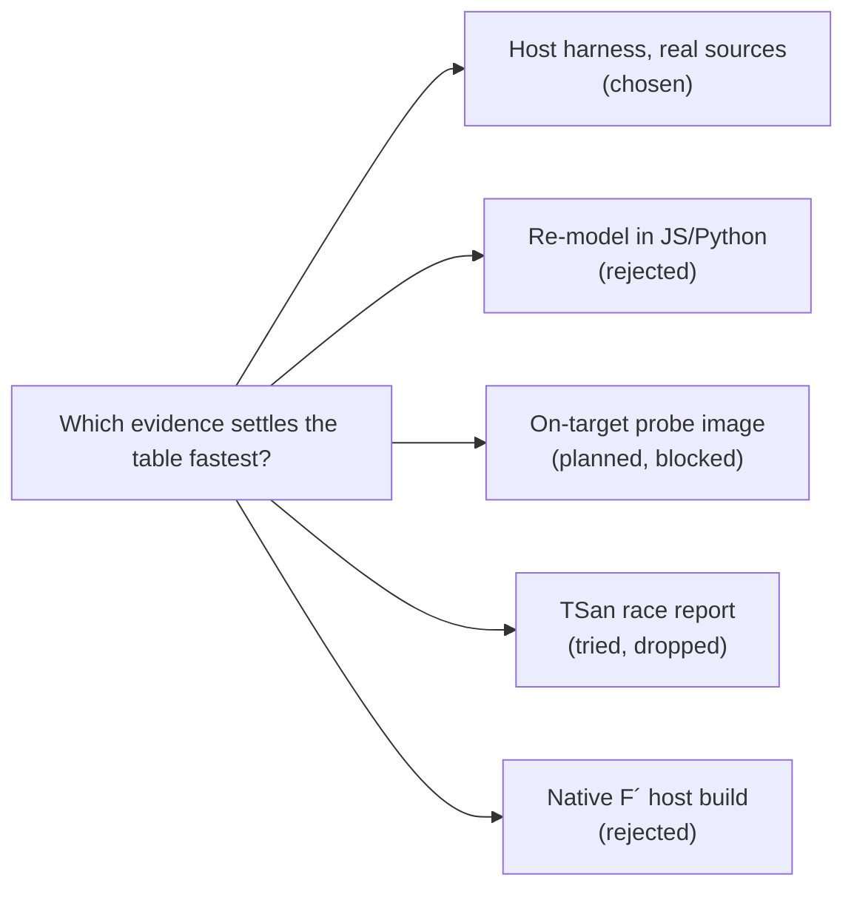

# Rationale: approaches considered (arena c1)

| Approach | Verdict | Why |
|---|---|---|
| **Host harness that compiles the real sources** | Chosen | It compiles `radio_planner.c` and `smtc_rac.c` at the pinned v1.0.0 fork and at upstream v1.2.1, plus `RalSessionImpl.cpp`, `UspRadio.cpp`, `ProfilePolicy.cpp`, the option-2 `RalSessionSt.cpp`, and the option-3 diff applied by `patch`. Fakes sit only at the edges: the Zephyr kernel on pthreads, the SX1262 behind `ral_drv_t`, the usp_zephyr HAL, and the F´ queue. Claims A, B, F and the line counts are decided by control flow, and this harness runs that control flow. |
| Re-model each option (like `concurrency-demo.html`) | Rejected | A model encodes the author's reading of the planner. Claim B shows the risk: the table says `tasks[0xFF]` gets read, but the real code panics first, in `SMTC_RAC_CHECK_RADIO_ACCESS_ID`. |
| Native F´ host build (fpp autocoder + Os/Posix) | Rejected | Too slow to set up for the value it adds. The one F´ behaviour that matters is the stable max-priority queue, priority 10 vs 0, depth 10, assert on full. The fake base reproduces it from `Os/Generic/Types/MaxHeap` and the generated send-then-assert code. |
| ThreadSanitizer over the stress scenario | Tried, dropped | The TSan builds of the variants that run the USP thread hang on macOS arm64. The option-2 build runs fine under TSan. I did not find the root cause within the time box. For claim E, I used direct evidence instead: a counter of RAL calls that overlap from two threads, with thread and function attribution. |
| On-target probe image (k_timer "DIO1" into a pump thread, plus timing of stop/apply/startReceive on the v5e) | Planned, blocked | This is the only way to get real numbers for G (kick latency under the real thread mix) and for the 50 ms re-arm claim. The session's permission policy denied SSH to the bench Pi, so I did not build or flash a board image. Claims G and re-arm are reported as host structure plus computed budgets, and are marked **not measured on target**. |
| Priority emulation on host (SCHED_FIFO) | Rejected | macOS does not give strict priority preemption to user threads. Any priority or latency number from the host would be fiction. The host harness reports counts and orderings, not target times. |
