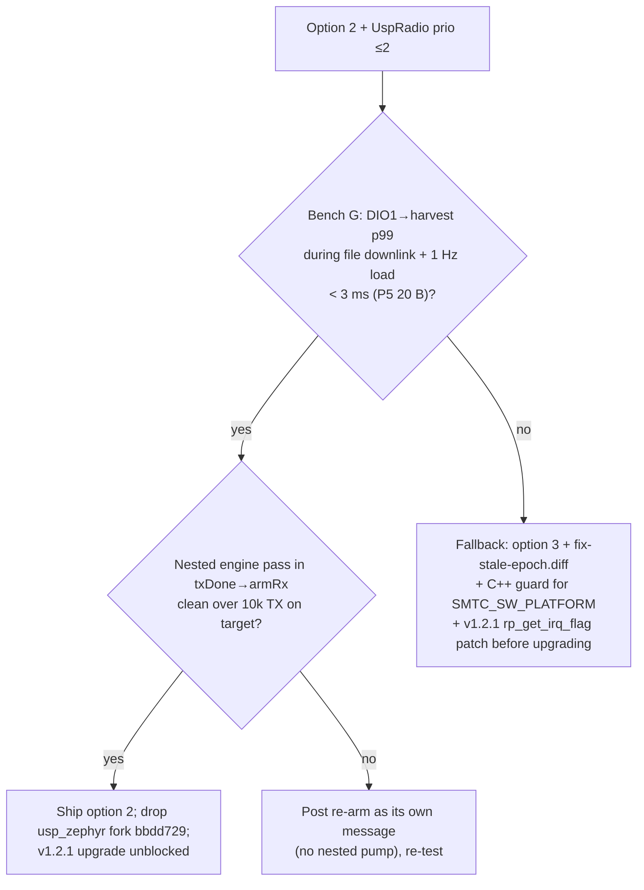

# #589 recommendation (arena c1)

**Go with option 2 (single queue), with UspRadio raised to Zephyr priority ≤2. One bench session on G gates it. If G fails, fall back to option 3 with the epoch fix and a C++-safe mutex guard.**

## Why option 2

The table below scores each option on the measured or computed results in RESULTS.md.

| Decision input | Opt 1 | Opt 3 | Opt 2 |
|---|---|---|---|
| A: stale false confirm (10 trials) | 10/10 | 10/10 | 0/10 (frame dropped) |
| A: with a 24-line epoch fix | 0/10, frame kept | 0/10 (same fix) | n/a |
| E: two threads in the RAL (60 s stress, two runs) | 4 and 39 | 0 | 0 |
| F: v1.2.1 engine spin | 1.17×10⁷ passes/s | same loop | 0 |
| Async `run` starvation without ComDelay | FW_ASSERT at 10 s | FW_ASSERT | 12/12 served |
| Compiles on target as written | yes | **no** (`__auto_type`) | no (2 small fixes) |
| Cross-thread waits per TX frame | 2.05 + 1.1 sleeps | same | 0 |
| RX duty, PCR-like 100 ms pacing | 89 % | ≈ opt 1 | 96 % |
| Code: k_sem / atomics / k_sleep / `tasks[]` | 16+4 / 26 / 4 / 8 | 16+4 / 26 / 4 / 1 | 1 / 3 / 0 / 0 |
| Unmeasured risk | — | inversion ≤6 SPI cmds | G: harvest at prio 11 |

- **Option 2 removes whole classes of problems.** Options 1 and 3 patch them one at a time. With one thread in the RAC there is no cross-thread RAL access, no `tasks[]` polling, no semaphore handshake for stop and apply, and no exposure to the v1.2.1 `rp_get_irq_flag` change. Options 1 and 3 can reach option 2's score on A (the epoch fix) and on E (option 3). They cannot reach it on F without patching upstream usp, and they keep the starvation latch that ComDelay currently hides.
- **Claim A no longer decides anything.** The epoch fix closes it in options 1 and 3, and it does so better than option 2, because it keeps the frame.
- **Claim B no longer decides anything.** It is unreachable in all three options.

## What would change my mind

1. **G fails at prio ≤2.** That would mean a DIO1-to-harvest p99 above the frame budget during a file downlink, which is 3 ms for 20 B and 25 ms for 252 B at P5. Option 2 then loses frames that option 1 keeps in its ring. In that case, take the fallback.
2. **Running UspRadio at prio 2 starves something.** In option 2, `rxFrame` runs the whole sync RX chain inside the engine pass: frameAccumulator (passive in `ComCcsdsLora/ComCcsds.fpp:38`), then the TC deframer, tcSecurityDeframer authentication and the router. A heavy uplink would then run at prio 2. If rateGroup10Hz shows slips, option 2 needs RX delivery split into a lower-priority message. That costs one more queue hop.
3. **The nested `pump()` misbehaves on target.** In `txDone` → `finishFrame` → `armRx`, `lock` runs inside the outer `rp_callback`, and the outer pass then runs `rp_task_call_aborted` and the arbiter on top. It was clean in every host run, but host timing is not target timing.
4. **The ~50 ms re-arm cost is real on target and comes from SPI/BUSY.** If it is not cross-thread waits, option 2's always-re-arm (+12 RAL calls per frame) would cost throughput. ComDelay's ≥100 ms frame spacing makes this unlikely to matter.

## Bench drills that remain (dev v5e, RX only, no TX/CW)

| # | Drill | Measures | Pass |
|---|---|---|---|
| 1 | k_timer "DIO1" at 40 Hz → `k_sem_give(event sem)` → kick pump (prio 1) → UspRadio handler entry, `k_cycle_get_32` histogram read over OpenOCD. Run with the real PCR thread mix and the UspRadio prio as built | G kick latency (p50/p99/max) | p99 < 3 ms at the shipped prio |
| 2 | Time `stopRadio` / `applyProfile` / `startReceive` in today's image: 100 same-profile `SET_RX_PROFILE` levers | Whether the "~50 ms" is real; per-RAL-call SPI cost | report |
| 3 | `CONFIG_SCHED_THREAD_USAGE` per-thread CPU with RX armed, v1.0.0 vs a v1.2.1 build | F on target | v1.0.0 USP thread ≈0 % idle |
| 4 | Option 2 build, 10k start/stop/arm cycles plus synthetic kicks | nested-pump safety, `stop()` synchronous | 0 panics, chip in RX at the end |
| 5 | Option 3 build after a C++ guard replaces `SMTC_SW_PLATFORM` (fallback only) | inversion: USP thread wait on `rac_api_mutex` | max wait < 1 ms |

## Carry-overs whatever is chosen

- Apply `fix-stale-epoch.diff` (or an equivalent) if option 1 or 3 ships, even temporarily.
- Remove the `tasks[0xFF]` row from the table. Replace it with "a failed init cannot happen: open_radio panics".
- Note that the skip-re-arm optimisation never fires while ComDelay paces downlink (≥100 ms). Each frame still costs the 5 ms deaf poll.
