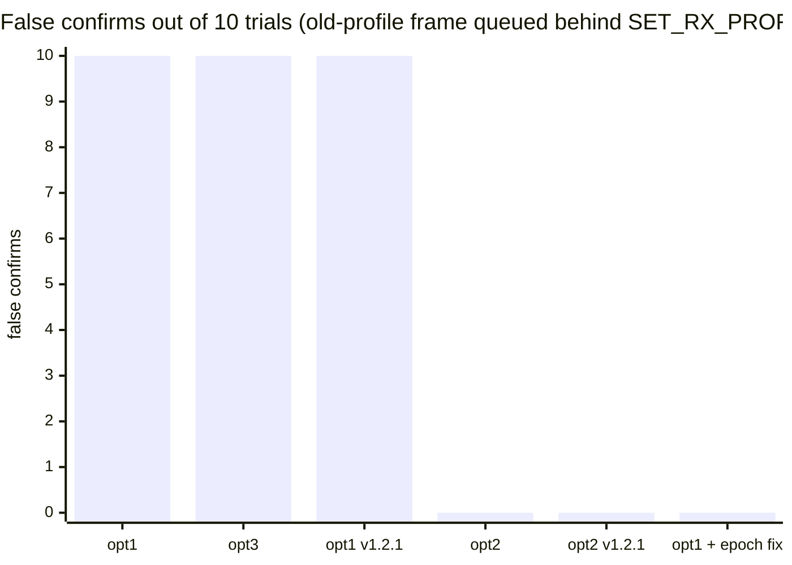
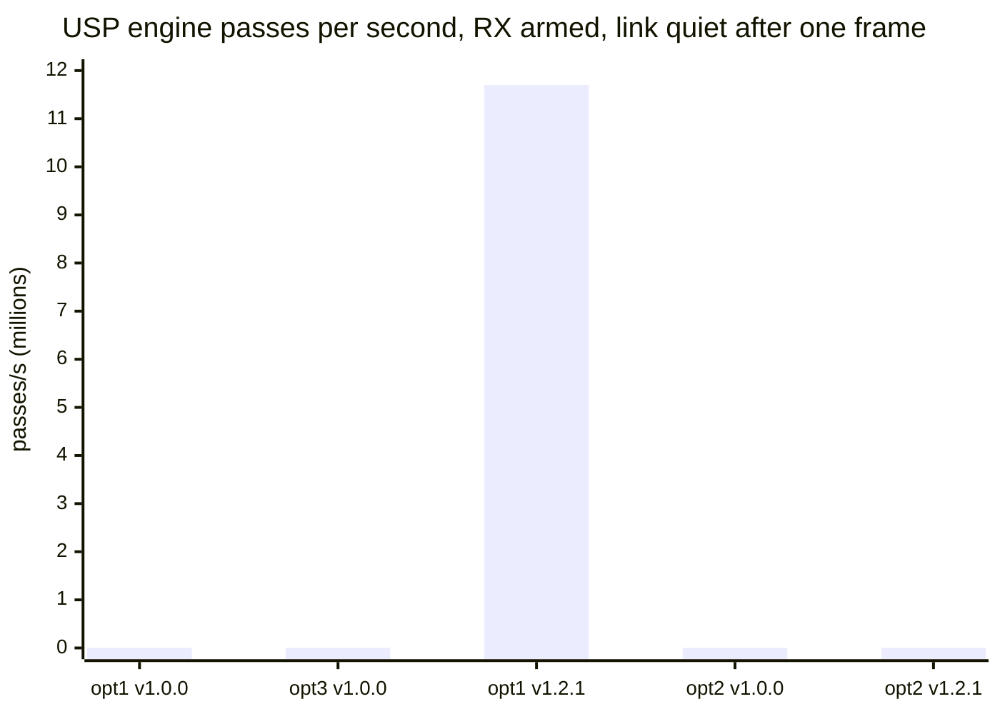
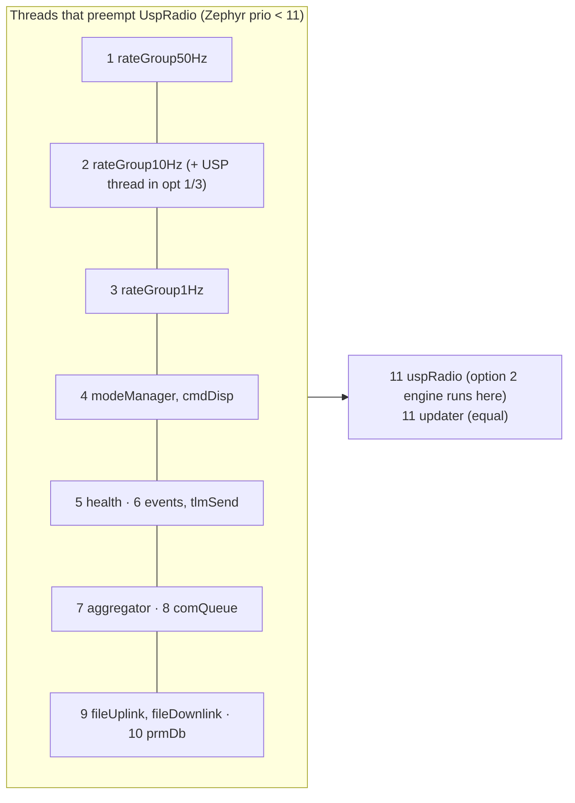

# #589 arena c1: results

Everything below was measured on the **host** (macOS arm64). The harness compiles the **real** sources:

- `radio_planner.c` and `smtc_rac.c` from the pinned usp v1.0.0 fork, and again from upstream v1.2.1.
- `RalSessionImpl.cpp`, `UspRadio.cpp` and `ProfilePolicy.cpp` at 25d5cd2.
- Option 2's `RalSessionSt.cpp`.
- Option 3's diff, applied with `patch`.

Fakes sit only at the edges: the Zephyr kernel on pthreads, the SX1262 behind `ral_drv_t`, the usp_zephyr HAL, and the F´ active-component queue. No on-target numbers exist, because SSH to the bench Pi was denied by this session's permission policy (see RATIONALE.md). To rerun everything, use `./run.sh`. Raw logs are in `results/raw/`, the flat table is `results/summary.tsv`, and the panics and asserts are in `results/aborts.txt`.

## Verdicts at a glance

| Claim | Verdict | Key number | Evidence |
|---|---|---|---|
| A. Stale-frame false confirm (options 1 and 3) | **Confirmed** | 10/10 false confirms in options 1 and 3; 0/10 in option 2 | `raw/*_stale.log` |
| A'. Option 2 "cannot" | **Confirmed, with a cost** | Option 2 drops the in-flight old-profile frame (10/10 dropped) | `raw/opt2_stale.log` |
| A''. Closable inside option 1 | **New** | 24-line epoch stamp: 0/10 false confirms, 10/10 old frames still delivered, 3/3 genuine confirms | `fix-stale-epoch.diff`, `raw/opt1fix_*` |
| B. `tasks[0xFF]` after a failed init | **Refuted** (in all three options) | `open_radio` cannot return 0xFF after `smtc_rac_init`; every UspRadio path panics first (MCU reset) | `raw/*_init_fail_*.log` |
| E. Engine vs. caller-thread RAL access (option 1) | **Partly confirmed, intermittent** | Two threads in the RAL at once, option-1 concurrency code: 4 times in 60 s (committed run), 39 in 60 s (earlier run). Option 3: 0, option 2: 0. All option-1 overlaps are `quiesceRadio` vs. the engine. Lock vs. engine overlaps: 0 with the fork mutex, 20 without | `raw/*_stress_*.log` |
| F. v1.2.1 USP thread busy-loop | **Confirmed** (host, real v1.2.1 code) | 0 passes/s on v1.0.0; **1.17×10⁷ passes/s, one core at 100 %** on v1.2.1 after the first frame; option 2 on v1.2.1: 0 | `raw/*_busyloop.log` |
| G. Option 2 RX service budget | **Budget confirmed; latency not measured** | 25.2 ms for P5 252 B as claimed, but **3.0 ms** for a 20 B frame at P5. 13 F´ threads and the system workqueue outrank UspRadio (prio 11) | `raw/airtime.tsv` |
| Re-arm ~50 ms (option 1) | **Not reproduced; moot in PCR** | Host stop→re-arm is 0.29 ms with 2 cross-thread waits (option 2: 0.26 ms, 0 waits). ComDelay spaces frames ≥100 ms, so the 5 ms skip window never fires | `raw/*_rearm.log`, `raw/*_txsat.log` |
| Option 3 priority inversion | **Bounded** | Caller holds `rac_api_mutex` across ≤6 RAL calls; `k_mutex` priority inheritance applies | `raw/opt3_rearm.log` |
| Option 3 as written | **New: does not compile on target** | `SMTC_SW_PLATFORM` uses `__auto_type`, which GCC 14 rejects in C++ | `raw/opt3_gcc_auto_type.log` |
| Line and primitive counts | **Consistent** | 941 code lines (table: 920); 16 k_sem take/give + 4 init; 26 atomics; 4 k_sleep; 8 `tasks[]` (option 3: 1) | `raw/line_counts.tsv` |
| Queue blocked in TX (options 1 and 3) | **Confirmed, new consequence** | With ComDelay bypassed, the async `run` port starves: 0 of 10 served, then FW_ASSERT on queue full. Option 2: 12/12 served | `raw/*_starve.log` |

## A. Stale-frame false confirm

```mermaid
sequenceDiagram
    participant G as Ground (old profile P0)
    participant U as USP thread (prio 2)
    participant Q as UspRadio queue
    participant C as Component thread
    Note over C: SET_RX_PROFILE P3 handler posts deferredSetRxProfile
    G->>U: frame on P0 (DIO1)
    U->>Q: ring slot + deferredRxDone (queued BEHIND deferredSetRxProfile)
    C->>C: setRxProfile(P3) pending, stop, apply P3, arm
    C->>C: deferredRxDone: frameReceived() → kConfirmRx(P3)
    Note over C: Options 1/3: P3 committed on a P0 frame; the auto-revert is disarmed
    Note over C: Option 2: abort retypes the LOCK to UNLOCK. The pending IRQ is consumed as RADIO_UNLOCKED, and the frame is never read
```



- **How it was measured.** The harness injects a P0 frame into the fake chip at the moment `deferredSetRxProfile` is enqueued, then lets the real DIO1 → engine → `onPostRx` → ring path run. The revert deadline is 1 s, and a `run` tick is sent at 1.1 s.
- **Controls.**
  - With no injected frame, each variant reverts 3/3 times and confirms 0/3 (`*_stale_ctrl`).
  - A frame on the new profile confirms 3/3 in every variant (`*_confirm_new`).
- **Why option 2 is immune.** This follows the real planner code. `rp_task_abort` changes the RUNNING LOCK to `UNLOCK_RADIO_ACCESS` (`radio_planner.c:400`), and `rp_irq_get_status` returns `RP_STATUS_RADIO_UNLOCKED` for that type without reading the chip (`:797-800`). The frame is never harvested. The cost is that the frame is lost: `old_frames_dropped=10`. A command repeated on the old profile is dropped rather than delivered.
- **Impact in options 1 and 3.** The new profile is committed on evidence from the old one, and the revert never fires (`reverts=0`). If the new profile cannot actually close the link, the uplink stays on a dead profile, and the auto-revert was the only recovery for that.
- **The fix inside options 1 and 3** is `fix-stale-epoch.diff`, +24/−2:
  - Count RX arms in `onPreRx`.
  - Stamp each ring slot with the arm count at harvest.
  - Confirm only on slots from the arm that put the pending profile on the chip.
  - Result: 0/10 false confirms, 10/10 old frames still delivered, and 3/3 genuine confirms. This beats option 2 on this claim, because it delivers the frame instead of dropping it.

## B. `tasks[0xFF]` after a failed init

| Path (session with `m_radio_id = 0xFF`) | Options 1 and 3 | Option 2 |
|---|---|---|
| `stopRadio()` / `stop()` | `SMTC_MODEM_HAL_PANIC` at `smtc_rac_abort_radio_submit:475`, then MCU reset | `-ENODEV` |
| `applyProfile()` / `armRx()` | PANIC at `smtc_rac_lock_radio_access:498`, then reset | `-EIO` |
| `transmitPacket()` / `startTx()` | PANIC at `smtc_rac_lock_radio_access:498`, then reset | `-EIO` |
| `startReceive()` called directly | reads `tasks[0xFF]` (OOB) and returns `-EBUSY` | n/a |

- **How the session gets `0xFF`.** `smtc_rac_open_radio` returns `RAC_INVALID_RADIO_ID` only when `rp_hook_init` fails, and `rp_hook_init` calls `SMTC_MODEM_HAL_PANIC` before it returns the error. This holds in v1.0.0 `radio_planner.c:257-269` and in v1.2.1 `:270-281`. `RalSessionImpl::init()` runs `smtc_rac_init()` (`rp_init` memsets all hooks) right before the open, so the open cannot fail. The harness tested this: it pre-took the hook, and `startRadio()` still returned OK (`startRadio_ok_with_hook_pre_taken=1`).
- **Why the OOB read is unreachable.** The only direct `tasks[0xFF]` read is `startReceive()`'s poll. UspRadio reaches it only after `init()` succeeded (in `startRadio`) or after `applyProfile()` succeeded (in `rearmRx`). Both of those go through the RAC id check first.
- The row does not separate the options. Delete it from the table.

## E. Engine vs. caller-thread RAL access

| Variant (3 × 10 s stress) | Two threads inside the RAL at once | Attributed to |
|---|---|---|
| Option 1 (fork mutex) | 0, 0, 0 (+ option 1 with epoch fix, same concurrency code: 0, 0, 4) | the component's `quiesceRadio` (`ral_set_standby`, `ral_clear_irq_status`) vs. the USP thread's `ral_set_sleep` |
| Option 1 without the fork mutex | 21, 18, 18 | additionally, the inline pre-callback of `smtc_rac_lock_radio_access` (`set_pkt_type`, `set_lora_*`, `set_rf_freq`, `set_tx_cfg`) vs. the engine (20 of the attributed overlaps; at most 20 are attributed per run) |
| Option 3 | 0, 0, 0 | — |
| Option 2 | 0, 0, 0 | — |

- **Stress load:**
  - Ground frames every 1–4 ms on random profiles.
  - Downlink paced by a 10 ms ComDelay model.
  - Random `SET_RX_PROFILE`, `SET_TX_PROFILE` and `run` every 20–60 ms.
  - Panics and FW_ASSERTs: 0 in all variants.
- **Not shown.** Races on planner memory (`rp->tasks[]`) are invisible to this counter. The TSan builds hung (see RATIONALE.md).
- **Earlier run.** An earlier full run of the same harness gave option 1: 0, 4, 4 and epoch fix: 4, 4, 19. The interleave is real but rare.
- **Verdict.** Option 1 leaves two threads in the RAL at the same time, and option 3 closes it in this run. The lock-vs-engine interleave the table names was **not observed with the fork mutex** in 120 s across both runs, although nothing prevents it. The interleave that was observed is `quiesceRadio`, which is the access the research note's F5 flags.

## F. v1.2.1 busy-loop



- **What runs.** Real v1.2.1 `rp_get_irq_flag` (`radio_planner.c:600-612`) inside the `usp_main_thread` loop (`zephyr_usp_thread.c:136`, copied line for line).
- **What happens.** After the first DIO1 with the RX LOCK current, `smtc_rac_is_irq_flag_pending()` never returns false again, so the thread never sleeps. On host it eats a core at 100 %. RX still works on host (10/10), because the host has more cores.
- **On target (inference from the Zephyr scheduler rule).** A prio-2 thread that never blocks starves every thread at prio 3 and below: rateGroup1Hz (3), modeManager and cmdDisp (4), events (6), comQueue (8), and UspRadio (11). rateGroup50Hz (1) is unaffected. This is **measured on host with the real code, inferred for the target**.
- **Option 2 on v1.2.1.** No spin, because the engine runs only on kicks from the event semaphore.

## G. Option 2's RX service budget

Here is the airtime of one frame, which is the time before the next back-to-back frame overwrites the RX buffer (`tools/airtime.py`):

| Profile | 20 B | 100 B | 252 B |
|---|---|---|---|
| P0 LoRa SF8 | 102.9 ms | 307.7 ms | 696.8 ms |
| P2 LoRa SF5 | 17.2 ms | 58.2 ms | 136.3 ms |
| P3 GFSK 38k4 | 6.5 ms | 23.1 ms | 54.8 ms |
| P4 GFSK 75k | 3.3 ms | 11.8 ms | 28.1 ms |
| **P5 GMSK 83k** | **3.0 ms** | 10.7 ms | **25.2 ms** |



- **The 25 ms figure is correct for 252 B frames only.** Back-to-back short uplink frames at P5 leave 3 ms.
- **The latency itself was not measured.** That needs the target. In option 1 the harvest runs at prio 2. In option 2 it runs at prio 11 behind 13 F´ threads and the system workqueue, including fileDownlink, comQueue and aggregator, which are busiest during a pass. Thread priorities come from `instances.fpp` and `project/config/*Config.fpp`.
- **Mitigation, from code reading.** Run UspRadio at Zephyr prio ≤2. That is where the engine runs today, so option 2's harvest would not get worse than option 1's.

## Re-arm cost and the skip-re-arm optimisation

| Per cycle or frame (host) | Option 1 | Option 3 | Option 2 |
|---|---|---|---|
| stop → apply → arm: wall time | 0.29 ms | 0.29 ms | 0.26 ms |
| …cross-thread `k_sem` waits | 2 | 2 | 0 |
| …RAL calls | 14 | 14 | 13 |
| TX frame: blocking waits + `k_sleep` on the component thread | 2.05 + 1.1 (1.6 ms) | 2.05 + 1.1 | 0 + 0 |
| TX frame: RX re-arms | 0.025 | 0.025 | 1.0 |
| TX frame: RAL calls | 16.3 | 16.3 | 28 |
| RX duty cycle in stress, 10 ms ComDelay | 8 % | 8 % | 64 % |
| RX duty cycle in stress, 100 ms ComDelay (PCR-like) | 89 % | — | 96 % |

- **What the host shows.** The cross-thread waits cost microseconds on host when the USP thread is free (the fake SPI is 20 µs per RAL call). Nothing in the code structure makes ~50 ms. The figure must come from target scheduling or an older revision, and only the bench can settle it.
- **Why it doesn't matter in PCR.** `uspRadio.comStatusOut → downlinkDelay` (ComDelay, released on a rateGroup10Hz tick, default divider 299) spaces frames at least 100 ms apart. The 5 ms "frame pending?" window therefore never sees a next frame, so option 1 re-arms every frame anyway. Each frame still pays the 5 ms poll, during which the radio is deaf.
- **Option 2's always-re-arm** costs 1 arm and 12 more RAL calls per frame, which is about 12 × SPI command time. Option 2 still delivered 96 % RX duty against 88 %.
- **ComDelay bypassed** (`raw/*_starve.log`). In options 1 and 3, a priority-10 `deferredTxPacket` is always queued ahead of priority 0, so the rateGroup1Hz `run` port is never served: 0/10. The 10-deep queue then fills, and F´ FW_ASSERTs at 10.5 s. Option 2 serves 12/12. This is latent: it needs the ComDelay divider removed.

## Option 3 specifics

- **Compile.**
  - `SMTC_SW_PLATFORM` (usp_zephyr `smtc_sw_platform_helper.h:73-87`) is a GNU statement expression with `__auto_type`.
  - `arm-zephyr-eabi-g++ 14.3.0` fails with `'__auto_type' was not declared in this scope`. Clang accepts it, which is why the host harness builds.
  - The fix: call the macro from a C shim, or use a C++ guard on `rac_api_mutex`.
  - The diff also needs the `hookState()` declaration its header note mentions. The harness adds it.
- **Inversion.** The component thread's longest `rac_api_mutex` hold is 6 RAL calls: the inline pre-callback of a lock. The USP thread's longest is 1–2. `k_mutex` has priority inheritance, so the inversion is bounded by those 6 SPI commands. Their target duration was **not measured**.
- **Otherwise** option 3 behaves exactly like option 1 on A, F, re-arm and starvation, because those are not mutex problems.

## Option 2 sketch: what it took to run

- It needed 2 compile fixes, both applied by the Makefile to a copy in scratch:
  - a missing `#include <zephyr/lorawan_lbm/lorawan_hal_init.h>` for `smtc_modem_hal_get_event_sem`;
  - `rp_disable_failsafe()` is called with 1 argument but takes 2.
- 6 elided bodies had to be filled from RalSessionImpl.cpp (`src/ralsession_st_glue.cpp`, about 110 lines).
- **The TX path re-enters the engine.** `txDone` → `finishFrame` → `armRx` → `lock` → `pump()` runs inside `rp_hook_callback` of the outer engine pass. It worked in every scenario here: 0 panics, and 719–731 TX per 10 s stress run. It is still the riskiest structural trait of the sketch and should be reviewed against the planner's arbiter tail.

## Line and primitive counts

| Set | Code lines | k_sem calls | atomics | k_sleep | `tasks[]` |
|---|---|---|---|---|---|
| Option 1, `.cpp` + `.hpp` | 941 | 20 (16 take/give + 4 init) | 26 | 4 | 8 |
| Option 3, `.cpp` (diff applied) | 778 | 20 | 21 | 4 | 1 (via `hookState()`, 7 call sites) |
| Option 2 sketch + header | 364 + about 110 of elided bodies + unchanged handlers | 1 | 3 | 0 | 0 |

The table's 920, ~690 and ~927 agree within the counting rule. A code line here is a non-blank, non-comment line. The option-2 total cannot be measured until the sketch is complete.

## Skipped

- **Kick-latency number (G) and on-target stop/arm timing.** These need the board, and the board was blocked.
- **Race detection on planner memory.** TSan hung (see RATIONALE.md).
- **CW paths.** No RF transmission, and nothing in the decision depends on CW.
