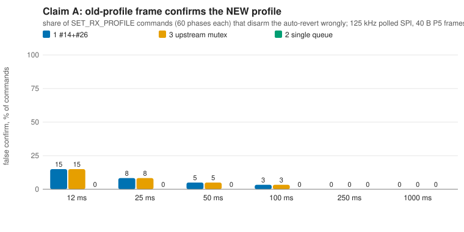
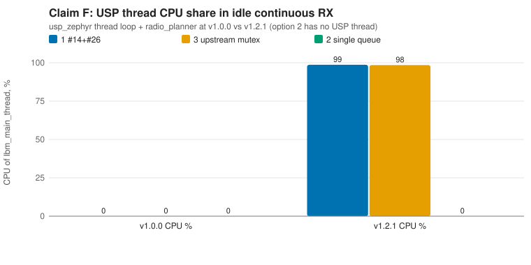
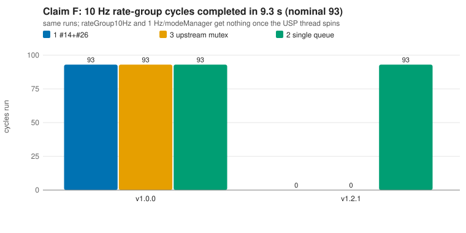
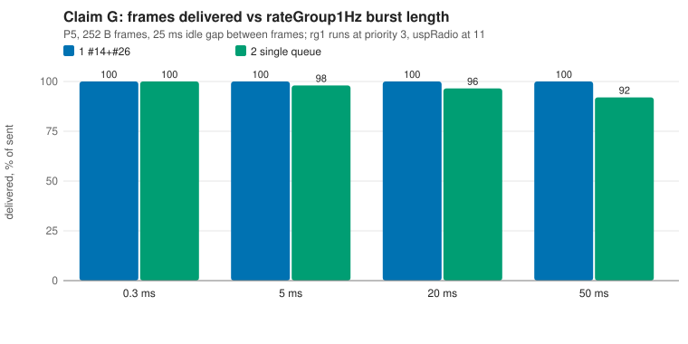
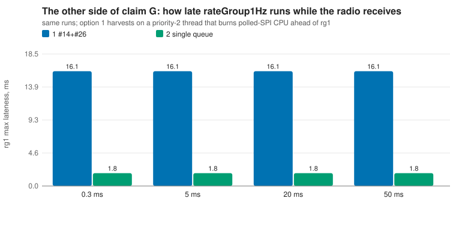
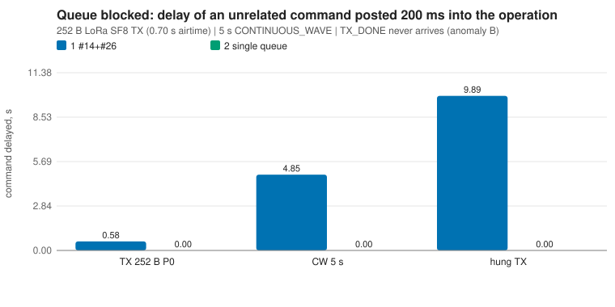

# Arena #589 / candidate c3: RESULTS

Rerun everything with `./run_all.sh` (about 1 minute; `QUICK=1` is faster). Raw RESULT lines are in `results/`,
the digest quoted below is `results/SUMMARY.txt`, charts are `results/figs/*.svg`. The runs are deterministic
(two full runs diff clean).

## What was measured, and how far to trust it

- **Real code:** radio_planner.c, smtc_rac*.c, ral/ralf_sx126x.c, sx126x.c, usp_zephyr `sx126x_hal.c`,
  `sx126x_ral_bsp.c`, `smtc_modem_hal.c`, `zephyr_usp_thread.c` (pinned v1.0.0 + fork, and v1.2.1),
  `UspRadio.cpp`, `ProfilePolicy.cpp`, `RalSessionImpl.cpp`, option 3 = the prototype's diff applied.
  Option 2 is the sketch completed (`opt2/`, deviations marked `ARENA-c3:`).
- **Modelled:** the Zephyr kernel (`zsim/`: single core, strict priorities, PI mutexes, 20 ms slicing, virtual
  time), the SX1262 + SPI + GPIO (`chip/`), the FPP component base (`shim/`), rate-group CPU bursts.
- **Not done: the dev board.** The bench Pi SSH was denied by this session's permission classifier and I did
  not work around it. **Every timing number below is a host-model number, not an on-target number.** Race and
  logic verdicts (A, B, E, F, queue blocking) are structural and carry over; magnitudes (G, re-arm) do not
  until the drills in RECOMMENDATION.md are run.
- **Model inputs taken from the repo** (check them on target): v5e DTS `spi-max-frequency = <125000>`,
  `tcxo-wakeup-time = <10>`; build `.config` `CONFIG_SPI_PL022=y` with `_INTERRUPT` and `_DMA` unset (so a
  transfer polls and **burns CPU at the caller's priority**), `SYS_CLOCK_TICKS_PER_SEC=10000`,
  `TIMESLICE_SIZE=20`, no SMP; `RadioInstances_Usp.fppi` `priority 11`; `instances.fpp` rate groups 1/2/3,
  modeManager 4. **Assumed, not measured:** rate-group CPU bursts (0.3 ms / 1.5 ms / 4 ms / 0.5 ms baseline,
  swept where it matters), 15 us SPI driver overhead, 340 us wake, 25 us DIO1 latency.

## Verdicts

| Claim | Verdict | Key numbers (host model) |
| --- | --- | --- |
| A stale-frame false confirm (1, 3) | **confirmed; closed by option 2; also closable in 1/3 by an 8-line epoch tag** | 15% of SET_RX_PROFILE commands at an 83 fps stale stream, 8% at 40 fps, 5% at 20 fps, 3% at 10 fps, 0 at 4 fps and below; option 2: 0 of 360 |
| B `tasks[0xFF]` OOB read | **refuted as stated** | no OOB read is reachable: first RAC call with id 0xFF panics (reset); ASAN clean; the INVALID return is itself unreachable on target |
| E engine pass vs `lock_radio_access` (1) | **confirmed, and worse than "open"** | option 1 stalls the radio (HAL BUSY wait, no recovery) in 26 to 58% of 20 s storms; 1 stall per ~110 to 3000 operations depending on RX rate; deterministic 0.6 ms window; options 3 and 2: 0 stalls in 16.3k and 17.7k ops |
| F v1.2.1 busy loop (1, 3) | **confirmed, and wider than claimed** | USP thread 98.7% CPU in idle continuous RX; rateGroup10Hz, 1Hz, modeManager run 0 cycles in 9.3 s; option 2 unaffected |
| G option 2: RX service waits behind the queue | **confirmed, bounded by higher-priority bursts, not by the queue** | P5 252 B at 25 ms gap: 100% delivered at rg1 burst 0.3 ms, 98% at 5, 96% at 20, 92% at 50 (option 1: 100% throughout); on the other side option 1 delays rg1 by 16 ms and modeManager by 19 to 26 ms, option 2 does not |
| Re-arm cost | **sketch's "~1 ms" refuted; "~50 ms" not reproduced** | re-arm after TX: option 1 18.7 ms, option 2 22.6 ms (125 kHz, 10 ms TCXO); floor is the TCXO start, still 15.9 ms at 8 MHz SPI; always re-arming costs +9% on an 8-frame burst |
| Queue blocked in TX / CW | **confirmed** | probe delayed 577 ms (252 B SF8 TX), 4850 ms (5 s CW), 9893 ms (hung TX) in 1/3; 0.1 ms in 2 |
| Option 3 priority inversion | **bounded; not a real risk** | USP wait on `rac_api_mutex`: max 0.00 ms in normal traffic (PI), 29 ms under stray-IRQ stress; no-PI counterfactual 48 to 56 ms; holder holds up to 31 ms |
| Line / primitive counts | **confirmed, option 2 smaller than estimated** | 920 / 924 / 575 + 63 = 638 code lines; k_sem take+give 16 / 16 / 1; atomics 26 / 26 / 3; k_sleep 4 / 4 / 0; tasks[] 8 / 1 / 0 |

Not tested: real CW on RF, the TX-timeout path on a real chip, RadioHead compat paths, flash/NVS, anything on target.

## A. Stale-frame false confirm

Measured with `scen/stale.cpp`: a stream of P5 frames, `SET_RX_PROFILE P3` (3 s revert) at 60 phases across
one stream period, nobody ever transmits on P3. A ProfileConfirmed(P3) is false iff the frame consumed by that
handler was received on P5 (frame tags come from the chip model). Raw: `results/stale/`.

| stream period | opt1 | opt3 | opt2 | opt1 + epoch fix |
| --- | --- | --- | --- | --- |
| 12 ms | 9/60 | 9/60 | 0/60 | 0/60 |
| 25 ms | 5/60 | 5/60 | 0/60 | 0/60 |
| 50 ms | 3/60 | 3/60 | 0/60 | 0/60 |
| 100 ms | 2/60 | 2/60 | 0/60 | 0/60 |
| 250, 1000 ms | 0/60 | 0/60 | 0/60 | |

Each false confirm cancels the auto-revert, so the radio stays on a profile nobody uses ("stranded" counts in
SUMMARY: 12/60 at 12 ms in option 1 includes 3 radio stalls from claim E). Mechanism, from
`results/stale/timeline_opt1_p100ms_off55000.txt`: a P5 frame ends at 1113.34 ms, the command is posted at
1113.50, the frame is harvested into the ring at about 1118.3, the SetRxProfile handler (queued first) sets the
pending profile and takes 40 ms to stop/re-arm, then the ring slot is processed and confirms P3 at 1154.23
with a P5 payload. The window is the harvest-to-handler gap, about 2 to 3 ms with polled SPI (13/60 at
25 ms with IRQ-driven SPI, window 5 ms), so P(false) = window x stale-frame rate. A realistic trigger is a
continuous uplink burst that contains the command itself. Option 2 harvests only inside `pump()` on the thread
that changes the arm, so the order is serial and no old-profile frame can follow the pending change.

Fix for options 1/3 (`fixes/epoch_tag.diff`, 8 changed lines): stamp each ring slot with an RX epoch that the
component thread bumps after a successful stop for a profile change; a slot from an older epoch is delivered but
cannot confirm. 0/60 false confirms in options 1 and 3 at 12 to 100 ms (the 3 option-1 strandings left are
claim E).

## B. `tasks[0xFF]` after failed init

`scen/initfail.cpp` on ASAN builds (`results/initfail/`).

- With the call site seeing `RAC_INVALID_RADIO_ID` (`hal/fault_inject.h`), `startRadio()` returns false as the
  topology expects. The next command (`SET_RX_PROFILE`) reaches `smtc_rac_unlock_radio_access(0xFF)` and
  `SMTC_RAC_CHECK_RADIO_ACCESS_ID` panics ("radio_access_id is out of range", smtc_rac.c:475), which calls
  `smtc_modem_hal_reset_mcu`. ASAN reports nothing: no `tasks[0xFF]` read happens first, because every path that
  reads `tasks[m_radio_id]` (`startReceive`, `stopRadio`'s fast path) is preceded by a `lock/unlock` call that
  panics. So the defect is a reset loop on the first radio command after a failed init, not an OOB read.
- The INVALID return is unreachable on target: a second `smtc_rac_open_radio()` on a live hook panics inside
  `rp_hook_init` (radio_planner.c:266, `SMTC_MODEM_HAL_PANIC` before the status return). Failed init effectively
  means reset already at init.
- Option 2's `ready()` guard turns every command into `-ENODEV` with no panic (0 panics across all six commands).

## E. Engine pass vs caller race

Reading the source first: `smtc_rac_lock_radio_access()` does not call protect (smtc_rac.c:495 to 524); in
`rp_task_enqueue` the arbiter launches the pre-callback **inline on the caller's thread** and keeps touching
planner state afterwards; `quiesceRadio()` issues raw HAL calls; the HAL (`sx126x_hal.c`) has no lock around
`radio_status` / BUSY polling. The fork mutex only covers `smtc_rac_run_engine`, abort and the getters.

Evidence:
1. **Storms** (`scen/race.cpp`, 101 seeds x 20 s, random SET_RX/SET_TX/TRANSMIT/TX frames, RX frames every
   3 to 33 ms): stalled = a planner panic or RX never recovers after a 6 s drain.

   | variant | action gap <= 200 ms | action gap <= 1000 ms |
   | --- | --- | --- |
   | opt0 (no mutex at all; the pre-fork state) | 101/101 | 101/101 |
   | opt1 (fork mutex) | 59/101, 1 per 142 ops | 26/101, 1 per 108 ops |
   | opt3 (rac_api_mutex) | 0/101 in 13078 ops | 0/101 in 3181 ops |
   | opt2 | 0/101 in 14501 ops | 0/101 in 3204 ops |
   | opt3 + epoch fix | 0/101 | |

2. **Hazard scales with RX rate** (opt1, action gap <= 1000 ms): RX every ~18 ms: 1 stall per 108 ops; ~160 ms:
   1 per 436; ~1 s: 1 per 3092; none: 0 in 3125. Option 3: 0 in every row.
3. **Deterministic reproducer** (`scen/phase.cpp`, one RX frame, one operation, phase swept in 50 us steps):
   option 1 never recovers when the operation starts 0 to 650 us after the frame's RX_DONE (12 to 13 of 82
   phases for each of TX, SET_RX, SET_TX). Options 2 and 3: 0 of 246 per option.
4. **Mechanism** (SPI traces, `CHIP_TRACE=1`): the stray RX_DONE after the abort sends the USP thread into the
   planner's "radio IRQ, no task" path, which `ral_set_sleep()`s every hook (8 SetSleep sequences, about 14 ms of
   polled SPI). The component thread enters the HAL meanwhile; both see `radio_status == SLEEP`, both wake the
   chip, the USP thread sleeps it again, and the component thread then polls BUSY on a sleeping chip while the
   HAL believes it is awake. The HAL's wait is 600 s, then `k_oops()`.
5. **Sensitivity:** with an IRQ-driven SPI model (`CHIP_SPI_POLL=0`) there are no stalls in option 1 but 87
   lost commands to a sleeping chip in 101 seeds (the quiesce SetStandby), 0 in options 2 and 3. So the severity
   depends on the SPI driver mode, which the build `.config` says is polled.

Not reproduced: the July HWIL planner-struct corruption (RP_FAILSAFE, wrong task type). `zsim` preempts only at
kernel calls, SPI transfers and `zs_burn()`, so instruction-level interleavings are out of reach. Option 3 holds
`rac_api_mutex` across the whole enqueue including the inline pre-callback, which is why the stall disappears.

## F. usp v1.2.1 busy loop

 

`scen/busyloop.cpp` runs the real `zephyr_usp_thread.c` loop against the real planner at both versions, with the
deployment's rate-group priorities (`results/busyloop/`). A one-microsecond charge per loop iteration is added
at the flag test (`hal/thread_loop_cost.h`) so a spin takes virtual time.

| case | USP thread CPU | rg10 cycles (93 nominal) | rg1 cycles (9) | modeManager (18) | probe command latency |
| --- | --- | --- | --- | --- | --- |
| v1.0.0, opt1/opt3 | 0.0 to 1.1% | 93 | 9 | 18 | 0.1 ms |
| v1.2.1, opt1/opt3, no RX traffic | 98.7% | 0 | 0 | 0 | never ran |
| v1.2.1, opt1/opt3, RX 2 Hz | 97.9% | 38, late up to 399 ms | 3, late up to 3.8 s | 1 | 2 of 18 ran, max 227 ms |
| v1.2.1, option 2 | 0.0% | 93 | 9 | 18 | 0.1 ms |
| v1.2.1, opt1 with `USP_MAIN_THREAD_PRIORITY=14` | 96.5% | 93 | 9 | 18 | 0.1 ms |

So it is not only "during continuous RX": any time a LOCK task is the radio planner's current task, which is
always for `RalSessionImpl`. Option 2 has no USP thread; its bounded `pump()` loop never spins. Lowering the USP
thread to priority 14 stops the starvation but the CPU never idles (power not measured, inferred cost).

## G. Option 2's cost

 

`scen/latency.cpp`: P5, 252 B frames (25.2 ms airtime, 19.5 ms harvest at 125 kHz polled SPI), rg bursts swept
(`results/latency/`).

- **Kick latency** (RX_DONE to first SPI): 0.03 ms median in all options. Option 2's tail follows the bursts of
  threads above priority 11: p95 / max 0.03 / 2.2 ms at rg1 0.3 ms, 0.03 / 22 at 20 ms, 16 / 52 at 50 ms
  (option 1 max 1.7 ms throughout).
- **Loss** at 25 ms idle gap (rg1 bursts 0.3, 5, 20, 50 ms): option 1 0, 0, 0, 0 of 200 lost; option 2 0, 4, 7,
  16 (8 of the 16 are chip RX_DONEs overwritten before the harvest ran). At 60 ms gap only the 50 ms burst
  hurts (6 of 200). Equal-priority rateGroup10Hz bursts hurt both options alike (10 ms: 14 lost vs 49).
- **The same coin:** under that stream option 1's priority-2 USP thread burns 30% CPU of polled SPI and delays
  rateGroup1Hz by up to 16.1 ms and modeManager by 18.6 to 25.7 ms; option 2 leaves them at the 1.8 / 2.1 ms baseline.
- **Priority knob:** uspRadio at priority 3 (`RADIO_PRIO=3`): 0 lost but rg1 16.5 ms late (same as option 1);
  at 11 or 5: 4 lost, rg1 1.8 ms late.
- **`RadioInstances_Usp.fppi` is wrong in a comment that matters:** "Priority 11 is above the rate groups". In
  Zephyr a larger number is a lower priority and `Os/Task.cpp` passes the F-prime priority straight through, so
  uspRadio sits below rate groups 1 to 3 and modeManager 4.
- The unknown that decides G is the real longest burst of rateGroup1Hz and modeManager on target.

Side finding that matters more than the queue: at 125 kHz polled SPI a 252 B `ReadBuffer` is 16.3 ms, so a
P5 252 B stream with 5 ms gaps delivers 50 of 100 frames in **all three** options (`results/latency/gaps_*.txt`).

## Re-arm cost

`scen/rearm.cpp` (`results/rearm/`; ms from the command or `dataIn`):

| | option 1 | option 2 |
| --- | --- | --- |
| SET_RX_PROFILE to RX listening (125 kHz, TCXO 10 ms) | 24.4 | 21.9 |
| TX done to RX listening again (125 kHz, 10 ms) | 18.7 | 22.6 |
| same at 8 MHz SPI, 10 ms TCXO | 13.8 | 15.9 |
| same at 8 MHz SPI, 2 ms TCXO | 12.4 | 7.9 |
| 8 x 252 B burst, 125 kHz / 1 MHz / 8 MHz | 631 / 453 / 434 | 690 / 470 / 444 |

The floor is the planner putting the chip to sleep after every task and the TCXO start-up on wake (10 ms in the
DTS), not cross-thread waiting. Option 2's synchronous arm is not about 1 ms; dropping the skip-re-arm
optimisation costs +9% on an 8-frame burst at the board's SPI clock (+2% at 8 MHz). Option 1's skip works: RX is deaf for the whole burst.

## Queue blocked in TX / CW

`scen/blocked.cpp` (`results/blocked/`). Option 1/3: a probe command posted 200 ms in waits 577 ms behind a
252 B SF8 TX, 4850 ms behind a 5 s CW, 9893 ms behind a hung TX; this includes a TRANSMIT DISABLE. Option 2:
0.1 ms in all three, and the hung frame is returned by the run-tick watchdog at 10.16 s (1 s granularity).
Radio recovers in every case.

## Option 3 priority inversion

`scen/mutexwait.cpp` (`results/mutexwait/`): a priority-5 hog with 3 / 20 / 40 ms bursts tries to preempt the
holder; `NO_PI=1` removes inheritance (counterfactual, Zephyr `k_mutex` always inherits). Normal traffic with
PI: the USP thread blocks 198 to 366 times, each under 5 us (max prints 0.00 ms); the no-PI counterfactual
reaches 55.8 ms at a 40 ms hog. Stress (a stray DIO1 every 20 to 40 ms): 500 and 572 waits, max 29 ms and 28 ms
with PI (about the longest hold of 31 ms, an SPI-heavy lock window), 48 ms without PI plus a 20 ms hog. A hog can stretch the holder's
hold to 192 ms but only matters if the engine needs the mutex then. Under that stress option 3 shows 4 to 30
ConfigurationFailed events in 20 s; option 1 stalls outright (tx_returned 0).
The SPI bus lock (`spi_context_lock`) is a plain binary semaphore, so options 1 and 3 also have a
priority inversion on the bus itself that PI cannot fix; option 2 has one SPI user.

## Line and primitive counts

`results/loc.txt`: option 1 920 (matches the table), option 3 924 (table ~927), option 2 completed 575 +
63 (`apply_params.inc`, unchanged from #26) = 638 versus the ~690 estimate. k_sem take+give 16 / 16 / 1,
atomics 26 / 26 / 3, k_sleep 4 / 4 / 0, `tasks[]` reads 8 / 1 / 0, k_mutex or SMTC_SW_PLATFORM sites 0 / 11 / 0,
threads created 0 / 0 / 1.

## Other findings from completing and running the sketch

- Option 2 sketch bugs: `m_state = next` was set after `smtc_rac_lock_radio_access` returned although the
  pre-callback may run (and fail, unlocking to IDLE) inside it; `rp_disable_failsafe(rp)` needs `(rp, true)`.
  Fixed, marked `ARENA-c3:`.
- `UspRadio::nowMs()` returns 0 off-target, so host tests of the auto-revert cannot fire without
  `-D__ZEPHYR__`.
- v5e DTS SPI is 125 kHz and polled: per-frame harvest is 5 ms (40 B) to 19.5 ms (252 B) of CPU. Verify on target
  first; every magnitude above scales with it.

## Model limits

Single core, kernel semantics re-implemented (PI, slicing, tick rounding checked by reading Zephyr, not by
running it); preemption only at kernel/SPI points; chip model implements the opcodes the driver uses, retention
and BUSY timing are datasheet-flavoured assumptions; rate-group bursts are assumed; TX is modelled airtime only
(no RF anywhere).
